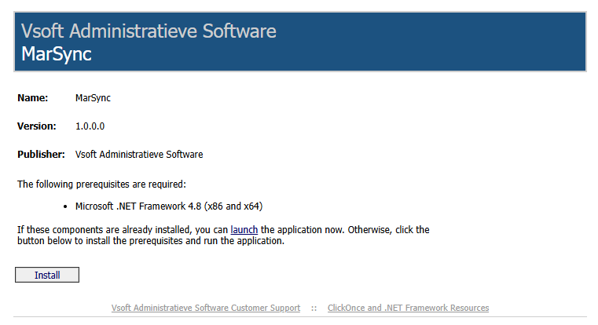

# MarSync

## [ClickOnce][ClickOnce]



## MarSync History (before know as MARIO)

Mario stood for M.A.R. Input Output Data transfer of our accounting data to different OS or Frameworks in the past.

- It was a project started in 1986 for porting accounting data from systems created by Mallard BASIC B-Plus tree from CP/M to MS-DOS.
- Few years later when Windows 3.1 and Visual Basic 2.0 came around the corner in 1992, it did the transfer between Mallard Basic B-Plus tree data to NOVELL B+ tree database.
- In 1995, we ported the databases to Windows 95 for use with Visual Basic 4.0 who also serves an indexing database called Jet Engine (Microsoft Access).
- These days, MarSync is a .NET application that can be used to export the Jet Engine database to a sqlserver database on a local or remote server.
- Added functionality from 2025, support for Peppol exchange sending and receiving invoices, credit notes and orders.

## MarSync Features

- Exporting data from Jet Engine database to SQL Server database.
- Support for Peppol exchange sending and receiving invoices, credit notes, reactions and orders.
- User-friendly interface for managing data transfers and Peppol transactions.

## MarSync is open source

We made MarSync open source to allow accountants having more control over their many clients company data folders (001 till 097) and to enable their own developers to view and eventually customize the application to their specific needs.

## Ademico Peppol API Testing

For MarIntegraal we have implemented the Peppol API from Ademico. New users can try MarIntegraal and MarSync in a testing mode using the API environment provided by Ademico, before taking next steps to production mode or live environment.

Before compiling the project, in the MarSync.Classes folder you need to add your secrets in an Secrets.cs file like this:

```csharp
namespace MarSync.Classes.Ademico
{
    internal class MyApiSecrets
    {
        internal static readonly string testBaseUrl = "https://test.com/whatever";
        internal static readonly string testAccessToken = "your-test-access-token";
        internal static readonly string testUsername = "your-test-username";
        internal static readonly string testPassword = "your-test-password";

        internal static readonly string prodBaseUrl = "https://production.com/whatever";
        internal static readonly string prodAccessToken = "your-production-access-token";
        internal static readonly string prodUsername = "your-production-username";
        internal static readonly string prodPassword = "your-production-password";

        internal static readonly string guidTestAccess = "Guid for user testing mode";
        internal static readonly string guidProdAccess = "Guid for user production mode";
        internal static readonly string guidToggleTabs = "Guid to allow user access to all tabs";

        internal static readonly string smtpServer = "domain on OUR hosting!";
        internal static readonly int smtpPort = 465;
        internal static readonly bool smtpUseSsl = true;
        internal static readonly string smtpUsername = "smtp username on OUR webmail hosting!";
        internal static readonly string smtpPassword = "smtp password on OUR webmail hosting!";

        internal static readonly string marSyncAdminEmail = "admin email adress";
        internal static readonly string marSyncAdminName = "admin name service desk";
    }
}
```

[ClickOnce]: https://clickonce.vsoft.be/MarSync/publish.htm
